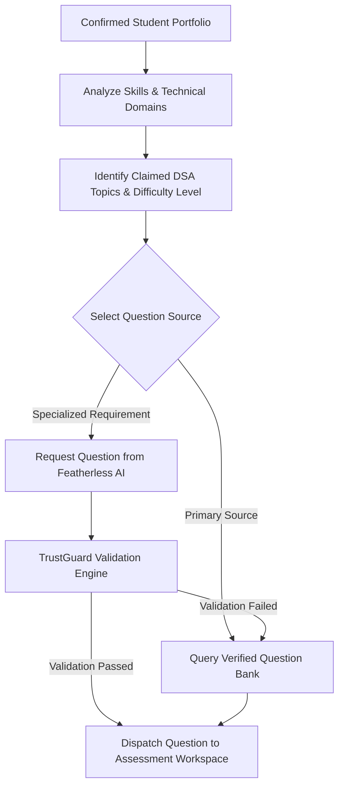
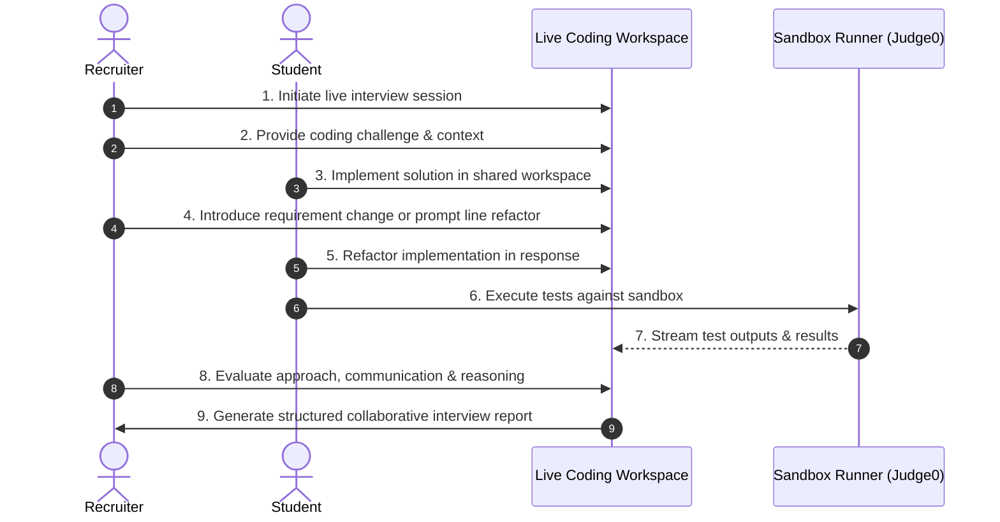

# SkillProof AI — Project Requirements Document

> **Document Type:** System & Product Requirements Document  
> **Project Name:** SkillProof AI  
> **Project Title:** Portfolio-Driven Adaptive Coding & Technical Assessment Platform  
> **Status:** Approved Baseline  
> **Primary Milestone:** End-to-End Student Assessment Loop  

---

## 1. Project Overview

### 1.1 Project Title & Name
- **Name:** SkillProof AI
- **Title:** Portfolio-Driven Adaptive Coding & Technical Assessment Platform

### 1.2 Purpose & Mission
Traditional assessment platforms evaluate candidates by counting completed questions, multiple-choice quizzes, or algorithmic drills that fail to reflect real-world software engineering capabilities. **SkillProof AI** provides an AI-assisted evaluation platform that measures candidates on:
- Actual technical abilities and practical implementation skills.
- Problem-solving methodologies and architectural approaches.
- Verified project experience and domain understanding.
- Transparent and deterministic problem resolution rather than test-count volume.

### 1.3 Target User Roles
The platform natively supports three distinct user archetypes:
1. **Students:** Candidates seeking to validate their practical technical skills, practice domain-specific challenges, receive structured AI guidance, and share verified technical proof with recruiters.
2. **College Administrators:** Academic staff and department leads managing cohorts, deploying customized domain assessments, tracking collective academic performance, and bridging curricula with industry skills.
3. **Verified Recruiters:** Technical recruiters and hiring managers who search candidates by demonstrated technical proof, review verified evaluation dossiers with candidate consent, and conduct live collaborative technical interviews.

---

## 2. Technology Stack

### 2.1 Planned Technologies

| Layer | Technology | Primary Function |
| :--- | :--- | :--- |
| **Frontend Framework** | React + Vite | Fast, responsive single-page application UI |
| **Styling** | Tailwind CSS | Utility-first component styling and responsive themes |
| **Code Editor** | Monaco Editor | In-browser professional coding workspace |
| **Data Visualization** | Recharts | Interactive performance analytics, progress graphs, and metrics |
| **Backend API** | Python + FastAPI | High-performance asynchronous REST endpoints and agent orchestration |
| **Database & Auth** | Supabase | Managed PostgreSQL, Row-Level Security (RLS), and authentication |
| **AI LLM Provider** | Featherless AI API | High-throughput, model-diverse inference for generation and assistance |
| **Agent Coordination** | LangGraph | Stateful multi-step agent workflows for assessment orchestration |
| **Code Execution** | Judge0 (or isolated service) | Sandboxed, secure, multi-language execution engine |
| **Version Control** | Git & GitHub | Source control, issue tracking, and collaborative development |

### 2.2 Operational Constraints & Development Principles
- **Prefer Free Tools & Free Tiers:** Prioritize free tiers and open-source tooling for development and initial deployment.
- **Verify Limits:** Never assume an external service is free without verifying current rate limits, quotas, and pricing models.
- **Zero Hardcoded Secrets:** Never hardcode API keys, tokens, or credentials in codebase files.
- **Environment Variables:** All secrets, endpoints, and credentials must be loaded securely via environment variables (`.env`).
- **Configurable AI Provider:** Keep the AI engine decoupled behind an abstraction layer to allow switching or fallback across providers.
- **No Mandatory Subscriptions:** The core system must run without requiring paid user or developer subscriptions.
- **Sensible Fallbacks:** If an external API (e.g., Featherless AI, Judge0) is degraded or unreachable, the system must degrade gracefully with sensible fallbacks (e.g., fall back to verified question bank).

---

## 3. User Authentication and Role-Based Dashboards

### 3.1 Role Capabilities

```
┌────────────────────────────────────────────────────────────────────────┐
│                        Role-Based Capabilities                         │
├────────────────────┬─────────────────────────────┬─────────────────────┤
│      Student       │    College Administrator    │ Verified Recruiter  │
├────────────────────┼─────────────────────────────┼─────────────────────┤
│ • Register / Login │ • Manage students & batches │ • Search candidates │
│ • Upload portfolio │ • Create custom assessments │ • View reports with │
│ • Take assessments │ • Add domain coding tasks   │   student consent   │
│ • Practice coding  │ • Assign tasks to cohorts   │ • Review proof data │
│ • Guarded AI help  │ • Set assessment deadlines  │ • Conduct live pair │
│ • Analytics graphs │ • Monitor cohort analytics  │   coding interviews │
└────────────────────┴─────────────────────────────┴─────────────────────┘
```

#### Student Dashboard
- User registration, authentication, and session handling.
- Portfolio and project information upload portal.
- Personalized adaptive assessment launcher.
- Dedicated skill-improvement and practice hub.
- Guarded AI assistance interface (available based on assessment level).
- Performance reports, skill mastery breakdown, and historical progress graphs.

#### College Administrator Dashboard
- Student and batch/cohort organization and management.
- Custom assessment creation and scheduling.
- Addition and configuration of college-specific coding challenges.
- Assignment of tasks to specific students or batches with strict deadlines.
- Real-time monitoring of batch completion rates and analytics.

#### Recruiter Portal
- Candidate discovery engine filtering by verified technical skills and domains.
- Access to candidate assessment dossiers **only with explicit candidate consent**.
- Detailed inspection of candidate coding timelines, problem-solving methods, and test proofs.
- Live collaborative technical coding interview environment.

### 3.2 Authorization Enforcement
- Role-based access control (RBAC) must be enforced at the **backend API and database layers** (e.g., Supabase RLS and FastAPI route dependencies).
- Simply hiding UI navigation items or frontend routes is insufficient for security.

---

## 4. Portfolio Upload and Analysis

### 4.1 Input Formats
Students can upload structured or unstructured project summaries in the following formats:
- **JSON** (direct structured payload)
- **PDF** (documents and resume extracts)
- **DOCX** (standard word processing documents where practical)

### 4.2 Information Extraction & Normalization
The ingestion pipeline extracts and structures:
- **Project Names & Descriptions**
- **Technologies Used** (languages, frameworks, libraries, databases)
- **Claimed Skills** (e.g., REST API design, state management, caching)
- **Technical Domains** (e.g., Web Development, Backend Development, Machine Learning, Cybersecurity)
- **DSA Topics Claimed** (e.g., Arrays, Hash Tables, Trees, Dynamic Programming, Graphs)

### 4.3 Standardized Schema & Candidate Verification
- Extracted details are normalized into a validated, standardized JSON schema.
- **Mandatory Review Step:** Extracted data must be presented to the student for confirmation and manual correction before triggering any assessment.
- **Core Truth Principle:** Mentioning a technology or project in a portfolio **must never** automatically prove proficiency in that technology. It only defines the candidate's eligible assessment boundary.

---

## 5. Verified Question Bank

### 5.1 Question Classification Metadata
All questions within the verified question bank must be comprehensively structured with:
- **Unique Identifier & Title**
- **Technical Domain:** Web Development, Machine Learning, Cybersecurity, Backend Development
- **Programming Language:** (e.g., Python, JavaScript, TypeScript, Go)
- **DSA Topic:** (e.g., Binary Search, Graph Traversal, Two Pointers, Dynamic Programming)
- **Difficulty Tier:** Easy, Medium, Hard
- **Question Type:** Localized bug fix, feature implementation, multi-file refactoring, algorithmic challenge
- **Problem Statement & Constraints:** Explicit input/output formats, time/space constraints
- **Starter Code:** Clean skeleton template for the candidate
- **Reference Solution:** Known working, verified solution implementation
- **Test Suite:** Comprehensive public sample test cases and hidden evaluation test cases with expected outputs

### 5.2 Domains & Initial Repository Scope
- **Target Domains:** Web Development, Machine Learning, Cybersecurity, Backend Development
- **Difficulty Distribution:** Balanced across Easy, Medium, and Hard
- **Initial Bank Volume:** Begin with a curated, validated repository of **30–50 verified questions**.
- **Verification Rule:** Every question in the bank must be executed against reference solutions and test runners prior to production availability. AI-generated questions or test cases must never be trusted blindly.

---

## 6. SkillProof AI Assessment Agent

### 6.1 Architecture & Workflow (LangGraph)
A centralized assessment agent coordinates the adaptive evaluation process using **LangGraph**:



### 6.2 Agent Responsibilities
1. Ingest the candidate's verified and confirmed portfolio profile.
2. Detect confirmed skills, primary technical domains, and claimed DSA competencies.
3. Select an appropriate challenge from the verified question bank matching the profile.
4. When personalization requires novel generation, request a tailored question from Featherless AI.
5. Pipe any novel question through the **TrustGuard** validation pipeline (executing reference solution against test cases).
6. Release only verified questions that pass end-to-end deterministic checks.

### 6.3 Boundary Enforcement
- The agent must strictly respect the student's confirmed domain and claimed DSA topics.
- **Boundary Violation Rule:** The agent must never produce or assign questions outside the agreed portfolio boundaries without explicitly notifying and seeking confirmation from the student.
- The **Verified Question Bank** remains the primary, preferred question source.

---

## 7. Assessment Levels

Assessment challenges are divided into three distinct skill tiers:

| Tier | Level | Technical Scope | DSA Complexity | AI Coding Assistant |
| :--- | :--- | :--- | :--- | :--- |
| **NOVICE** | Easy | Localized bug fixes or single-function feature implementations | Easy DSA challenges | **Disabled** during verified assessments |
| **ADEPT** | Medium | Multi-step feature implementations; 2–3 files where applicable | Medium DSA challenges | **Guarded Assistant** enabled |
| **MASTER** | Hard | Multi-file architectural debugging, performance bottlenecks, feature extension | Medium to Hard DSA challenges | **Guarded Assistant** enabled |

- **Personalization:** Every assessment challenge is dynamically tailored to match the student's confirmed portfolio skills, chosen domain, and eligible topics.

---

## 8. Separate Skill-Improvement Assessment

### 8.1 Dedicated Practice Environment
- A standalone practice and self-paced learning portal distinct from the verified evaluation track.
- Offers non-evaluative practice challenges categorized into **Easy**, **Medium**, and **Hard**.
- Focuses on progressive learning, iterative experimentation, and guided skill acquisition.

### 8.2 Strict Data Isolation
- **Score Isolation:** Practice metrics, trial runs, and practice attempts must be kept strictly isolated from verified assessment scores.
- Practice data must **never pollute or inflate** candidate scores presented to recruiters.

---

## 9. Coding Workspace and Deterministic Grading

### 9.1 Workspace Components
- **Monaco Editor:** High-performance in-browser editor with syntax highlighting, line numbers, and indentation.
- **Context Panel:** Problem statement, constraints, input/output specifications, and sample test cases.
- **Language Switcher:** Support for permitted languages with appropriate starter boilerplate.
- **Execution Controls:** "Run Tests" (sample/custom test cases) and "Submit Assessment" (evaluation suite).
- **Console & Output:** Execution logs, standard output, compiler errors, and assertion failures.
- **Submission History:** Record of previous runs with execution timestamps and result status.

### 9.2 Execution Sandbox Safety
- Untrusted candidate code must **never** be executed on the application server.
- All code runs must execute inside an isolated execution sandbox (e.g., **Judge0** or dedicated containerized runner) with hard execution time, CPU, memory, and networking limits.

### 9.3 Deterministic Grading Engine
- Evaluation must be **100% deterministic**, driven by predefined automated test cases, unit assertions, validation scripts, and exact output matches.
- **Absolute Rule:** The LLM must **NEVER** independently determine whether a candidate's code submission is correct.

---

## 10. CodeTrace — Coding Journey

### 10.1 Captured Interaction Telemetry
To record a transparent, holistic coding journey, the system tracks:
- Exact submission and execution timestamps.
- Code revision history, major diffs, and structural milestones.
- Execution history of sample runs vs. final submissions.
- Test pass/fail states across iterative runs.
- Meaningful coding cadence events (e.g., major edits, syntax debugging runs).

### 10.2 Visualization & Privacy Governance
- **Interactive Timeline:** A readable, step-by-step visual timeline depicting how the candidate reasoned through the problem and iterated toward a solution.
- **Transparent Consent:** Students must be informed and provide consent regarding telemetry logging before beginning a verified assessment.
- **Anti-Dogmatism Policy:** Paste operations or specific editing intervals must **never** be interpreted as definitive proof of external AI usage or dishonesty. Telemetry serves as positive proof of genuine problem solving.

---

## 11. AI Coding Assistant

### 11.1 Capabilities
When enabled according to assessment mode, the AI Coding Assistant (powered by Featherless AI) provides:
- **Progressive Hinting:** Incremental hints without disclosing code directly.
- **Error Clarification:** Clear explanations of compiler errors, stack traces, and runtime exceptions.
- **Debugging Guidance:** Pointing out logical flaws, unhandled edge cases, or off-by-one errors.
- **Conceptual Clarification:** Explaining relevant algorithms, data structures, or library concepts.
- **Optimization Suggestions:** High-level advice on algorithmic complexity and resource efficiency.

### 11.2 Safety Rules & Guardrails
- **No Direct Solutions:** Never output complete reference solutions or full drop-in code blocks during verified assessments.
- **Hidden Tests Confidentiality:** Never reveal or describe hidden evaluation test cases.
- **Zero Reference Context:** Reference solutions must **never** be included in the prompt context supplied to the AI assistant.
- **Fallibility Disclosure:** AI assistance must be clearly labeled as advisory and potentially fallible.
- **Decoupled from Grading:** AI assistant conversations must remain strictly isolated from the deterministic grading engine.

### 11.3 Mode Matrix
- **Easy Verified Assessments:** Assistant is **completely disabled**.
- **Medium & Hard Verified Assessments:** Assistant operates under **guarded, progressive rules**.
- **Skill-Improvement Practice:** Assistant provides open learning assistance and educational explanations.

---

## 12. Performance Analytics and Scoring

### 12.1 Assessment Performance Report Components
- **Overall Composite Score** (normalized 0–100 scale)
- **Difficulty-Tier Performance:** Breakdown of success across Easy, Medium, and Hard tasks
- **Topic & Domain Mastery:** Categorized mastery across claimed skills and DSA topics
- **Test Execution Metrics:** Total test cases passed vs. failed, edge-case resilience
- **Efficiency & Iteration:** Number of incorrect submissions, turnaround time per challenge
- **Hint Utilization:** Number and depth of hints requested
- **Approach & Progression:** Summary of solution architecture and iterative diffs
- **Longitudinal Trend:** Progression across sequential assessments over time
- **AI Usage Efficiency Score:** Measurable metric of how productively assistance was utilized

### 12.2 Scoring Principles
1. **Demonstrated Competence First:** Evaluate practical code correctness, architecture, and problem-solving execution.
2. **Difficulty Weighting:** Balance scores according to question complexity and problem type.
3. **Quality Over Quantity:** Do **not** reward users for simply racking up test volumes or completing easy repetitive assessments.
4. **Constructive Failure Analysis:** Incorrect initial attempts or exploratory runs must not be automatically penalized as poor ability; thoughtful debugging is a natural engineering skill.
5. **Transparent Formula:** The scoring calculation must be deterministic, auditable, and clearly explained.

### 12.3 AI Usage Efficiency Component
- The AI Usage Efficiency component may contribute a maximum of **up to 20%** of the composite assessment score.
- This metric is computed **deterministically** using quantitative signals:
  - Evidence of positive code progression following a hint.
  - Active test execution and verification after receiving debugging guidance.
  - Absence of redundant or spam hint requests.
- **No LLM Scoring:** An LLM must **never** assign candidate scores or decide evaluation grades.

---

## 13. College Task Management

### 13.1 Administrative Capabilities
- **Cohort Organization:** Group students into batches, branches, years, or specialized tracks.
- **Custom Assessments:** Assemble custom assessment sets combining general and college-specific challenges.
- **Domain Coding Tasks:** Author and introduce proprietary, department-specific coding tasks.
- **Targeted Assignment:** Assign assessments to individual students or entire cohorts with explicit deadlines and time windows.
- **Cohort Monitoring:** Track cohort-wide submission rates, score distributions, and subject-matter deficiencies.

### 13.2 Institutional Quality Control
- Any college-authored question must pass through the **TrustGuard** verification pipeline (automated compilation, reference test run, schema validation) before deployment to students.

---

## 14. Recruiter Portal and Live Coding Interviews

### 14.1 Recruiter Discovery & Verification
- Filter candidates by verified technical skills, validated domains, and verified assessment tiers.
- Review detailed candidate assessment dossiers **only after receiving candidate consent**.
- Inspect candidate code diffs, execution logs, and CodeTrace journey timelines.

### 14.2 Live Collaborative Coding Workflow



---

## 15. AI Architecture and Reliability

### 15.1 Component Roles
- **LangGraph Agent:** Coordinates multi-step stateful workflows, from portfolio analysis to question dispatch.
- **Featherless AI:** Supplies language generation and contextual hints via API.
- **Verified Question Bank:** Serves as the primary source of reliable, ground-truth questions.
- **TrustGuard:** Automated gatekeeper validating generated questions (syntax, reference solution execution, test case assertions) before release.
- **Deterministic Test Engine:** Executes code against unit tests via Judge0 and computes pass/fail metrics.

### 15.2 Reliability & Fault-Tolerance Controls
- **Structured JSON Outputs:** Enforce strict schema validation on all AI interactions using Pydantic models.
- **Reference Solution Execution:** An AI-generated question is rejected if its included reference solution fails its own test cases.
- **Edge-Case Validation:** Test suites must include null, empty, boundary, and large input checks.
- **Resilient API Handling:** Robust handling for HTTP errors, timeouts, rate limits, and provider outages.
- **Graceful Fallback:** If Featherless AI is unresponsive or rate-limited, fallback immediately to the verified question bank without blocking the user.
- **Prompt Injection Defense:** Strict input sanitization and delimiter encapsulation to protect system prompts.
- **Zero Blind Trust:** Never treat an AI-generated question or test suite as valid without deterministic execution verification.

---

## 16. Security and Privacy

- **Authentication & RBAC:** Secure token-based session management with role-based policies enforced on FastAPI endpoints and Supabase RLS.
- **API Key Protection:** Secrets stored strictly in environment variables; never exposed to client bundles.
- **Input Sanitization:** Deep validation of all incoming payloads (file uploads, portfolio documents, user code submissions).
- **Safe File Uploads:** Restrict accepted file extensions (`.json`, `.pdf`, `.docx`), enforce maximum file size limits, and scan for malicious payloads.
- **Isolated Code Execution:** Complete sandboxing of user code with disabled network access, non-root execution, restricted memory, and strict timeouts.
- **Consent-Driven Recruiter Access:** Recruiter visibility into candidate dossiers requires explicit candidate permission.
- **Test Integrity:** Hidden test cases and reference solutions must never be leaked through frontend API responses or client-side storage.

---

## 17. Development Modules

Development is organized into 13 modular units structured across 4 progressive phases:

### Phase 1 – Foundation
- **Module 1: Project Setup and Application Foundation**  
  Initialize repository conventions, FastAPI backend scaffolding, React + Vite frontend setup, Tailwind styling, and Supabase connection.
- **Module 2: Authentication and Role-Based Dashboards**  
  Implement Supabase authentication, JWT verification, backend role enforcement, and distinct dashboards for Students, College Admins, and Recruiters.
- **Module 3: Portfolio Upload and JSON Conversion**  
  Build file upload endpoints (`.json`, `.pdf`, `.docx`), portfolio text extraction, standardization into normalized JSON schema, and candidate confirmation UI.

### Phase 2 – Assessment Intelligence
- **Module 4: Verified Question Bank**  
  Construct data models, database seeds, and CRUD endpoints for 30–50 verified questions categorized by domain, topic, difficulty, with starter code, reference solutions, and test cases.
- **Module 5: SkillProof AI Assessment Agent**  
  Implement LangGraph coordinator agent connecting portfolio data to question selection, Featherless AI prompt generation, and TrustGuard validation checks.
- **Module 6: Assessment and Skill-Improvement Pages**  
  Develop frontend assessment runner, tier-based launcher (Novice, Adept, Master), and separate non-evaluative practice module.
- **Module 7: Coding Workspace and Deterministic Grading**  
  Integrate Monaco editor, multi-language starter templates, Judge0 sandbox runner, and deterministic test result scoring.
- **Module 8: CodeTrace Coding Journey**  
  Implement client telemetry tracking (diffs, timestamps, test events), secure event logging, and timeline visualization.

### Phase 3 – Assistance and Analytics
- **Module 9: AI Coding Assistant**  
  Build guarded AI assistant interface using Featherless AI, with tier-specific assistance policies (disabled on Easy, progressive hints on Medium/Hard, solutions concealed).
- **Module 10: Performance Analytics and Scoring**  
  Develop scoring engine combining test case results, difficulty weighting, and deterministic AI usage efficiency; render Recharts performance dashboards.

### Phase 4 – Organization and Recruiting
- **Module 11: College Task Management**  
  Build batch management, custom assessment creator, validated question authoring, task assignment, and cohort monitoring for College Administrators.
- **Module 12: Recruiter Portal and Live Interviews**  
  Build candidate discovery search, consent-governed profile views, and shared Monaco-based collaborative live coding interview room.
- **Module 13: Integration, Security and Deployment**  
  Perform comprehensive security auditing, sandbox hardening, error boundary testing, rate limit verification, and deployment configurations.

---

## 18. Development Rules

To ensure stability, code quality, and alignment with architecture, all development must adhere to the following rules:

1. **One Module at a Time:** Complete, test, and verify each module before starting the next.
2. **Follow Requirements Strictly:** Adhere strictly to this requirements document throughout implementation.
3. **No Unapproved Deviations:** Do not skip, modify, or add features without prior discussion and agreement.
4. **No Premature Implementation:** Do not write code for future modules ahead of their phase.
5. **Inspect Before Modifying:** Always inspect existing code and architecture before making changes.
6. **Preserve Working Functionality:** Ensure new changes do not break previously implemented and verified features.
7. **Clean & Reusable Architecture:** Maintain clean separation of concerns, modular components, and documented APIs.
8. **Beginner-Friendly Explanations:** Explain complex architectural patterns and significant code changes in accessible, clear language.
9. **Rigorous Feature Testing:** Every feature must be tested and proven functional before marking the module complete.
10. **Transparent Status Reporting:** Clearly identify incomplete components or known limitations in status reports.
11. **Empirical Verification Only:** Never claim an integration or component works until it has been empirically executed and tested.

---

## 19. First Development Priority

### The Core Milestone: End-to-End Student Assessment Loop
Before undertaking complex multi-user portals, collaborative live interviews, or college batch scheduling, development must focus strictly on the core student assessment lifecycle:

```text
[1. Student uploads portfolio]
               │
               ▼
[2. Portfolio is analyzed & confirmed]
               │
               ▼
[3. Appropriate verified question is selected]
               │
               ▼
[4. Student solves question in Monaco editor]
               │
               ▼
[5. Backend executes & grades deterministically]
               │
               ▼
[6. Transparent performance report is generated]
```

**Guiding Rule:** A fully working end-to-end single-user assessment loop takes precedence over all advanced features.
