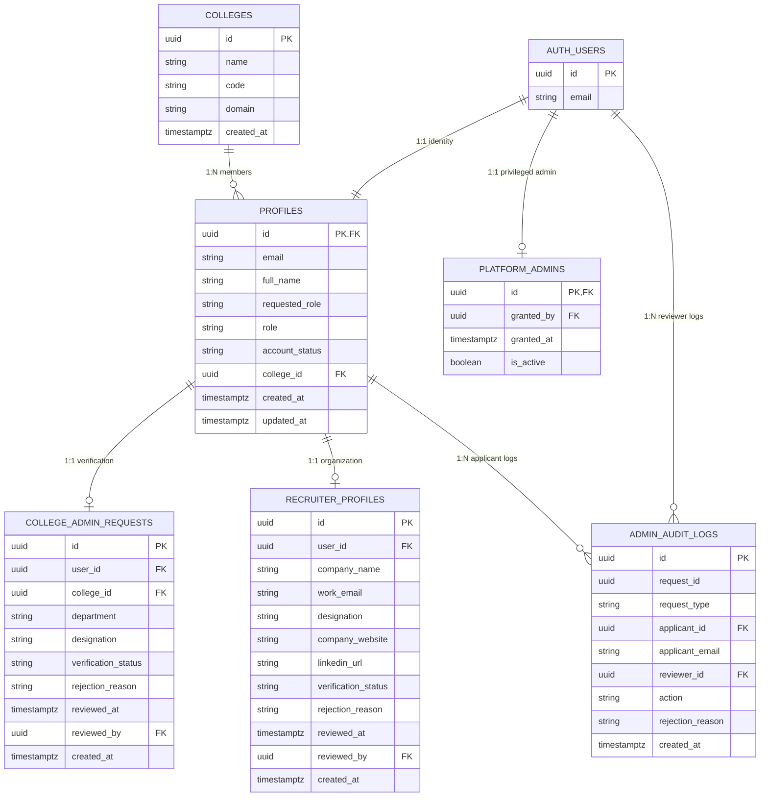

# SkillProof AI — Module 2: Authentication & Role-Based Dashboards Architecture

> **Document Type:** Technical Architecture Specification  
> **Module:** Module 2 — Authentication and Role-Based Dashboards  
> **Status:** Final Security Architecture & PostgreSQL Hardening Completed  
> **Target System:** SkillProof AI  
> **Database & Auth Engine:** Supabase (Auth + PostgreSQL RLS + Triggers + Least-Privilege Grants + Native RBAC + Audit Logs)  
> **Backend Framework:** Python 3.14 + FastAPI + PyJWT (JWKS Asymmetric Verification & Fail-Closed Guards)  
> **Frontend Framework:** React 18 + Vite + TypeScript + Tailwind CSS  

---

## 1. Architecture Overview

Module 2 provides identity management, role-based access control (RBAC), session persistence, and role-specific workspace shells for SkillProof AI.

```mermaid
flowchart TD
    subgraph Frontend["React 18 + Vite Client"]
        A[Login / Register UI] --> B[Supabase JS Client]
        C[Protected Route Guard] --> D{User Role & Status}
        D -->|Student (Active)| D1[Student Dashboard]
        D -->|College Admin (Approved)| D2[College Admin Dashboard]
        D -->|Recruiter (Approved)| D3[Recruiter Dashboard]
        D -->|Pending Approval| D4[Pending Verification Notice]
    end

    subgraph Supabase["Supabase Cloud / Free Tier"]
        B -->|Sign Up / Sign In| E[Supabase GoTrue Auth]
        E -->|Issues Signed JWT| B
        E -->|Trigger on signup| F[(public.profiles)]
        G[(public.college_admin_requests)]
        H[(public.recruiter_profiles)]
        I[(public.colleges)]
        PA[(public.platform_admins)]
        AL[(public.admin_audit_logs)]
        J[JWKS Public Endpoint: /.well-known/jwks.json]
    end

    subgraph Backend["FastAPI Backend Service"]
        B -->|Bearer JWT| K[FastAPI Auth Dependency]
        K -->|Fetch Public Key| J
        K -->|Cryptographic Signature, Iss, Aud, Exp Check| L{JWT Valid?}
        L -->|No| M[HTTP 401 Unauthorized]
        L -->|Yes| N[Query Verified Profile from DB]
        N --> O{Role Authorized & Status Active?}
        O -->|No| P[HTTP 403 Forbidden]
        O -->|Yes| Q[Protected Endpoint Execution]
        R[Admin Verification Endpoint] -->|Service Role Client| S[SECURITY DEFINER Approval Functions]
        S -->|Validates Reviewer against public.platform_admins| PA
        S -->|Row Locks & Atomic Promotion| F
        S -->|Append-Only Audit Entry| AL
    end
```

### Core Security & Architectural Principles
1. **Decoupled Identity & Cryptographic Verification:** Supabase Auth manages user credentials, password hashing, and token issuance. FastAPI independently validates JWTs against Supabase's public JWKS keys with fail-closed error handling and enforces RBAC authorization.
2. **Zero Trust in Client-Supplied Roles & Metadata:** A user's role and college affiliation are never accepted from client headers, localStorage, or signup payloads. Role state and institutional affiliations are maintained exclusively in the authoritative database and guarded against user mutation.
3. **Separation of Requested Role vs. Approved Role:** Applicants requesting privileged roles (`college_admin` or `recruiter`) start strictly as unprivileged users in a `pending_approval` state until an authorized platform administrator approves them.
4. **Four-Tier Database Defense (Unforgeable Engine Security):** Profile security is enforced at four distinct database layers:
   - **Row-Level Security (RLS):** Simple, non-recursive ownership policies (`auth.uid() = id`).
   - **SQL Column-Level Grants:** Strict least-privilege grants restricting client updates strictly to non-sensitive columns (`UPDATE (full_name)`).
   - **Invoker-Context Invariant Trigger Guard (`protect_profile_privileges`):** The trigger executes in the **caller's context (`SECURITY INVOKER`)**, checking `CURRENT_USER NOT IN ('postgres', 'supabase_admin')`. When an ordinary authenticated user runs direct SQL, `CURRENT_USER` is `authenticated` and mutations to protected columns are blocked. When trusted approval/rejection functions execute (which are `SECURITY DEFINER` owned by `postgres`), `CURRENT_USER` is `postgres` / `supabase_admin`, permitting authorized atomic updates.
   - **Dedicated SECURITY DEFINER Functions & Platform Admin Whitelisting:** Administrative functions (`approve_college_admin_request`, `approve_recruiter_request`, `reject_verification_request`) run as `SECURITY DEFINER` with fixed `SET search_path = ''`, acquire pessimistic row locks (`FOR UPDATE`), and verify the reviewer against `public.platform_admins`.
5. **No Reliance on Client-Settable Session Flags:** Replaced custom session variables (`app.privileged_operation`) entirely. Authorization is enforced natively by database roles, explicit permissions, and authoritative table lookups.
6. **Immutable Administrative Audit Logging:** All approval and rejection events are atomically recorded into an append-only `public.admin_audit_logs` table, recording request ID, applicant ID, reviewer ID, action, timestamp, and justification.
7. **Strict Search Path Isolation:** All `SECURITY DEFINER` functions execute with `SET search_path = ''` and fully schema-qualified object references to eliminate search path shadowing and privilege escalation attacks.
8. **Strict Service-Role Key Governance:** The Supabase `service_role` key is strictly confined to the backend server. It is never used as an authorization bypass.

---

## 2. Role and Permission Matrix

| Capability / Resource | Student (Active) | College Admin (Pending) | College Admin (Approved) | Recruiter (Pending) | Recruiter (Approved) | Platform Admin | Unauthenticated |
| :--- | :---: | :---: | :---: | :---: | :---: | :---: | :---: |
| **Register & Login** | Allowed | Allowed | Allowed | Allowed | Allowed | Allowed | Allowed |
| **Password Reset** | Allowed | Allowed | Allowed | Allowed | Allowed | Allowed | Allowed |
| **View Own Profile** | Allowed | Allowed | Allowed | Allowed | Allowed | Allowed | Denied (401) |
| **Update Own Full Name** | Allowed | Allowed | Allowed | Allowed | Allowed | Allowed | Denied (401) |
| **Modify Own Role/Status** | **Denied (Trigger)** | **Denied (Trigger)** | **Denied (Trigger)** | **Denied (Trigger)** | **Denied (Trigger)** | **Denied (Trigger)** | Denied (401) |
| **Self-Assign College Affiliation**| **Denied (Trigger)** | **Denied (Trigger)** | **Denied (Trigger)** | **Denied (Trigger)** | **Denied (Trigger)** | **Denied (Trigger)** | Denied (401) |
| **Submit Verification Request** | Denied | **Allowed (Pending only)** | Denied | **Allowed (Pending only)** | Denied | Denied | Denied (401) |
| **Approve/Reject Verification Requests** | **Denied (Grant)** | **Denied (Grant)** | **Denied (Grant)** | **Denied (Grant)** | **Denied (Grant)** | **Allowed (Service Role)** | Denied (401) |
| **View Administrative Audit Logs** | **Denied (RLS)** | **Denied (RLS)** | **Denied (RLS)** | **Denied (RLS)** | **Denied (RLS)** | **Allowed (Service Role)** | Denied (401) |
| **Student Dashboard** | **Allowed** | Denied (403) | Denied (403) | Denied (403) | Denied (403) | Denied (403) | Redirect (401) |
| **Upload Portfolio / Practice** | **Allowed** | Denied (403) | Denied (403) | Denied (403) | Denied (403) | Denied (403) | Redirect (401) |
| **College Dashboard** | Denied (403) | Pending View | **Allowed** | Denied (403) | Denied (403) | Denied (403) | Redirect (401) |
| **Manage Cohorts / Assign Tasks** | Denied (403) | Denied (403) | **Allowed** | Denied (403) | Denied (403) | Denied (403) | Redirect (401) |
| **Access Other College Data** | **Denied (RLS)** | **Denied (RLS)** | **Denied (RLS)** | **Denied (RLS)** | **Denied (RLS)** | **Denied (RLS)** | Denied (401) |
| **Recruiter Dashboard** | Denied (403) | Denied (403) | Denied (403) | Pending View | **Allowed** | Denied (403) | Redirect (401) |
| **Candidate Search & Dossiers** | Denied (403) | Denied (403) | Denied (403) | Denied (403) | **Allowed (Consented)** | Allowed (Audit) | Redirect (401) |
| **Access Unconsented Dossiers** | **Denied (RLS)** | **Denied (RLS)** | **Denied (RLS)** | **Denied (RLS)** | **Denied (RLS)** | **Denied (RLS)** | Denied (401) |

---

## 3. Database Schema & Least-Privilege Architecture

### 3.1 Entity Relationship Diagram



### 3.2 SQL Migration Specification (`supabase/migrations/001_auth_and_profiles.sql`)

```sql
-- =============================================================================
-- SkillProof AI — Database Schema: Authentication, Profiles & Hardened RBAC
-- =============================================================================

CREATE EXTENSION IF NOT EXISTS "uuid-ossp";

-- -----------------------------------------------------------------------------
-- 1. Colleges Table
-- -----------------------------------------------------------------------------
CREATE TABLE IF NOT EXISTS public.colleges (
    id UUID PRIMARY KEY DEFAULT uuid_generate_v4(),
    name TEXT NOT NULL UNIQUE,
    code TEXT UNIQUE,
    domain TEXT,
    created_at TIMESTAMPTZ NOT NULL DEFAULT timezone('utc'::text, now())
);

CREATE INDEX IF NOT EXISTS idx_colleges_name ON public.colleges(name);

-- -----------------------------------------------------------------------------
-- 2. Platform Administrators Registry Table
-- -----------------------------------------------------------------------------
CREATE TABLE IF NOT EXISTS public.platform_admins (
    id UUID PRIMARY KEY REFERENCES auth.users(id) ON DELETE CASCADE,
    granted_by UUID REFERENCES auth.users(id) ON DELETE SET NULL,
    granted_at TIMESTAMPTZ NOT NULL DEFAULT timezone('utc'::text, now()),
    is_active BOOLEAN NOT NULL DEFAULT true
);

CREATE INDEX IF NOT EXISTS idx_platform_admins_active ON public.platform_admins(is_active);

-- -----------------------------------------------------------------------------
-- 3. User Profiles Table
-- -----------------------------------------------------------------------------
CREATE TABLE IF NOT EXISTS public.profiles (
    id UUID PRIMARY KEY REFERENCES auth.users(id) ON DELETE CASCADE,
    email TEXT NOT NULL,
    full_name TEXT NOT NULL,
    requested_role TEXT NOT NULL DEFAULT 'student' CHECK (requested_role IN ('student', 'college_admin', 'recruiter')),
    role TEXT NOT NULL DEFAULT 'student' CHECK (role IN ('student', 'college_admin', 'recruiter')),
    account_status TEXT NOT NULL DEFAULT 'active' CHECK (account_status IN ('active', 'pending_approval', 'rejected', 'suspended')),
    college_id UUID REFERENCES public.colleges(id) ON DELETE SET NULL,
    created_at TIMESTAMPTZ NOT NULL DEFAULT timezone('utc'::text, now()),
    updated_at TIMESTAMPTZ NOT NULL DEFAULT timezone('utc'::text, now())
);

CREATE INDEX IF NOT EXISTS idx_profiles_role ON public.profiles(role);
CREATE INDEX IF NOT EXISTS idx_profiles_account_status ON public.profiles(account_status);
CREATE INDEX IF NOT EXISTS idx_profiles_college_id ON public.profiles(college_id);

-- -----------------------------------------------------------------------------
-- 4. College Administrator Verification Requests Table
-- -----------------------------------------------------------------------------
CREATE TABLE IF NOT EXISTS public.college_admin_requests (
    id UUID PRIMARY KEY DEFAULT uuid_generate_v4(),
    user_id UUID NOT NULL UNIQUE REFERENCES public.profiles(id) ON DELETE CASCADE,
    college_id UUID NOT NULL REFERENCES public.colleges(id) ON DELETE CASCADE,
    department TEXT NOT NULL,
    designation TEXT NOT NULL,
    verification_status TEXT NOT NULL DEFAULT 'pending' CHECK (verification_status IN ('pending', 'approved', 'rejected')),
    rejection_reason TEXT,
    reviewed_at TIMESTAMPTZ,
    reviewed_by UUID REFERENCES auth.users(id) ON DELETE SET NULL,
    created_at TIMESTAMPTZ NOT NULL DEFAULT timezone('utc'::text, now())
);

CREATE INDEX IF NOT EXISTS idx_college_admin_requests_status ON public.college_admin_requests(verification_status);

-- -----------------------------------------------------------------------------
-- 5. Recruiter Profiles & Verification Requests Table
-- -----------------------------------------------------------------------------
CREATE TABLE IF NOT EXISTS public.recruiter_profiles (
    id UUID PRIMARY KEY DEFAULT uuid_generate_v4(),
    user_id UUID NOT NULL UNIQUE REFERENCES public.profiles(id) ON DELETE CASCADE,
    company_name TEXT NOT NULL,
    work_email TEXT NOT NULL,
    designation TEXT NOT NULL,
    company_website TEXT,
    linkedin_url TEXT,
    verification_status TEXT NOT NULL DEFAULT 'pending' CHECK (verification_status IN ('pending', 'approved', 'rejected')),
    rejection_reason TEXT,
    reviewed_at TIMESTAMPTZ,
    reviewed_by UUID REFERENCES auth.users(id) ON DELETE SET NULL,
    created_at TIMESTAMPTZ NOT NULL DEFAULT timezone('utc'::text, now())
);

CREATE INDEX IF NOT EXISTS idx_recruiter_profiles_status ON public.recruiter_profiles(verification_status);

-- -----------------------------------------------------------------------------
-- 6. Administrative Audit Log Table
-- Append-only record of all verification approvals and rejections.
-- Retention-safe design: Deleting an applicant or reviewer preserves audit history.
-- Never modifiable or deletable by client connections.
-- -----------------------------------------------------------------------------
CREATE TABLE IF NOT EXISTS public.admin_audit_logs (
    id UUID PRIMARY KEY DEFAULT uuid_generate_v4(),
    request_id UUID NOT NULL,
    request_type TEXT NOT NULL CHECK (request_type IN ('college_admin', 'recruiter')),
    applicant_id UUID REFERENCES public.profiles(id) ON DELETE SET NULL,
    applicant_email TEXT,
    reviewer_id UUID REFERENCES auth.users(id) ON DELETE SET NULL,
    action TEXT NOT NULL CHECK (action IN ('approved', 'rejected')),
    rejection_reason TEXT,
    created_at TIMESTAMPTZ NOT NULL DEFAULT timezone('utc'::text, now())
);

CREATE INDEX IF NOT EXISTS idx_admin_audit_logs_request ON public.admin_audit_logs(request_id);
CREATE INDEX IF NOT EXISTS idx_admin_audit_logs_applicant ON public.admin_audit_logs(applicant_id);
CREATE INDEX IF NOT EXISTS idx_admin_audit_logs_reviewer ON public.admin_audit_logs(reviewer_id);

-- =============================================================================
-- Least-Privilege Grants and Revocations
-- =============================================================================

REVOKE ALL ON public.colleges FROM PUBLIC, anon, authenticated;
REVOKE ALL ON public.platform_admins FROM PUBLIC, anon, authenticated;
REVOKE ALL ON public.profiles FROM PUBLIC, anon, authenticated;
REVOKE ALL ON public.college_admin_requests FROM PUBLIC, anon, authenticated;
REVOKE ALL ON public.recruiter_profiles FROM PUBLIC, anon, authenticated;
REVOKE ALL ON public.admin_audit_logs FROM PUBLIC, anon, authenticated;

-- Colleges: Read-only access for listing institutions in registration forms
GRANT SELECT ON public.colleges TO anon, authenticated;

-- Platform Admins & Audit Logs: Readable only by service_role for backend administration
GRANT SELECT ON public.platform_admins TO service_role;
GRANT SELECT, INSERT ON public.admin_audit_logs TO service_role;

-- Profiles: Authenticated users can read own profiles, but can ONLY update full_name
GRANT SELECT ON public.profiles TO authenticated;
GRANT UPDATE (full_name) ON public.profiles TO authenticated;

-- Verification Requests: Users can view own requests and submit pending requests
GRANT SELECT, INSERT ON public.college_admin_requests TO authenticated;
GRANT SELECT, INSERT ON public.recruiter_profiles TO authenticated;

-- Administrative operations: service_role has full operational access
GRANT ALL ON public.colleges TO service_role;
GRANT ALL ON public.platform_admins TO service_role;
GRANT ALL ON public.profiles TO service_role;
GRANT ALL ON public.college_admin_requests TO service_role;
GRANT ALL ON public.recruiter_profiles TO service_role;
GRANT ALL ON public.admin_audit_logs TO service_role;

-- =============================================================================
-- Row Level Security (RLS) Policies
-- =============================================================================

ALTER TABLE public.colleges ENABLE ROW LEVEL SECURITY;
ALTER TABLE public.platform_admins ENABLE ROW LEVEL SECURITY;
ALTER TABLE public.profiles ENABLE ROW LEVEL SECURITY;
ALTER TABLE public.college_admin_requests ENABLE ROW LEVEL SECURITY;
ALTER TABLE public.recruiter_profiles ENABLE ROW LEVEL SECURITY;
ALTER TABLE public.admin_audit_logs ENABLE ROW LEVEL SECURITY;

CREATE POLICY "colleges_select_all" ON public.colleges FOR SELECT USING (true);
CREATE POLICY "platform_admins_deny_all" ON public.platform_admins FOR ALL USING (false);
CREATE POLICY "admin_audit_logs_deny_all" ON public.admin_audit_logs FOR ALL USING (false);

-- Profiles RLS: Simple own-row isolation
CREATE POLICY "profiles_select_own" ON public.profiles FOR SELECT USING (auth.uid() = id);
CREATE POLICY "profiles_update_own" ON public.profiles FOR UPDATE USING (auth.uid() = id) WITH CHECK (auth.uid() = id);

-- College Admin Requests RLS
CREATE POLICY "college_admin_requests_select_own" ON public.college_admin_requests FOR SELECT USING (auth.uid() = user_id);
CREATE POLICY "college_admin_requests_insert_own_pending" ON public.college_admin_requests FOR INSERT WITH CHECK (
    auth.uid() = user_id
    AND verification_status = 'pending'
    AND reviewed_by IS NULL
    AND reviewed_at IS NULL
    AND rejection_reason IS NULL
    AND EXISTS (
        SELECT 1 FROM public.profiles
        WHERE id = auth.uid()
          AND requested_role = 'college_admin'
          AND account_status = 'pending_approval'
    )
);

-- Recruiter Requests RLS
CREATE POLICY "recruiter_profiles_select_own" ON public.recruiter_profiles FOR SELECT USING (auth.uid() = user_id);
CREATE POLICY "recruiter_profiles_insert_own_pending" ON public.recruiter_profiles FOR INSERT WITH CHECK (
    auth.uid() = user_id
    AND verification_status = 'pending'
    AND reviewed_by IS NULL
    AND reviewed_at IS NULL
    AND rejection_reason IS NULL
    AND EXISTS (
        SELECT 1 FROM public.profiles
        WHERE id = auth.uid()
          AND requested_role = 'recruiter'
          AND account_status = 'pending_approval'
    )
);

-- =============================================================================
-- Database Functions and Hardened Triggers
-- =============================================================================

-- Trigger 1: Invariant Guard on Profiles UPDATE (Invoker Context)
-- Executes in the caller's context (SECURITY INVOKER, default).
-- Inspects standard CURRENT_USER.
-- When called directly by clients, CURRENT_USER is 'authenticated' -> blocked.
-- When called inside SECURITY DEFINER functions, CURRENT_USER is 'postgres'/'supabase_admin' -> permitted.
CREATE OR REPLACE FUNCTION public.protect_profile_privileges()
RETURNS TRIGGER 
SET search_path = ''
LANGUAGE plpgsql AS $$
BEGIN
    IF CURRENT_USER NOT IN ('postgres', 'supabase_admin') THEN
        IF NEW.role IS DISTINCT FROM OLD.role THEN
            RAISE EXCEPTION 'Unauthorized: role modification is restricted to administrative workflows.';
        END IF;
        IF NEW.account_status IS DISTINCT FROM OLD.account_status THEN
            RAISE EXCEPTION 'Unauthorized: account_status modification is restricted to administrative workflows.';
        END IF;
        IF NEW.college_id IS DISTINCT FROM OLD.college_id THEN
            RAISE EXCEPTION 'Unauthorized: college_id assignment is restricted to administrative workflows.';
        END IF;
        IF NEW.email IS DISTINCT FROM OLD.email THEN
            RAISE EXCEPTION 'Unauthorized: email must be changed through Supabase Auth.';
        END IF;
    END IF;

    NEW.updated_at := pg_catalog.timezone('utc'::pg_catalog.text, pg_catalog.now());
    RETURN NEW;
END;
$$;

DROP TRIGGER IF EXISTS trg_protect_profile_privileges ON public.profiles;
CREATE TRIGGER trg_protect_profile_privileges
    BEFORE UPDATE ON public.profiles
    FOR EACH ROW EXECUTE FUNCTION public.protect_profile_privileges();

-- Trigger 2: Handle User Signup safely without broad exception suppression
CREATE OR REPLACE FUNCTION public.handle_new_user()
RETURNS TRIGGER 
SECURITY DEFINER
SET search_path = ''
LANGUAGE plpgsql AS $$
DECLARE
    v_role pg_catalog.text;
    v_name pg_catalog.text;
BEGIN
    v_role := COALESCE(pg_catalog.btrim(NEW.raw_user_meta_data->>'requested_role'), 'student');
    IF v_role NOT IN ('student', 'college_admin', 'recruiter') THEN
        v_role := 'student';
    END IF;

    v_name := pg_catalog.btrim(COALESCE(NEW.raw_user_meta_data->>'full_name', ''));
    IF v_name = '' THEN
        v_name := 'SkillProof User';
    END IF;

    IF v_role = 'student' THEN
        INSERT INTO public.profiles (id, email, full_name, requested_role, role, account_status, college_id)
        VALUES (NEW.id, NEW.email, v_name, 'student', 'student', 'active', NULL);
    ELSE
        INSERT INTO public.profiles (id, email, full_name, requested_role, role, account_status, college_id)
        VALUES (NEW.id, NEW.email, v_name, v_role, 'student', 'pending_approval', NULL);
    END IF;

    RETURN NEW;
END;
$$;

DROP TRIGGER IF EXISTS on_auth_user_created ON auth.users;
CREATE TRIGGER on_auth_user_created
    AFTER INSERT ON auth.users
    FOR EACH ROW EXECUTE FUNCTION public.handle_new_user();

-- =============================================================================
-- Hardened Role Promotion & Rejection Functions (SECURITY DEFINER, service_role only)
-- =============================================================================

-- Approve College Administrator Request
CREATE OR REPLACE FUNCTION public.approve_college_admin_request(
    p_request_id UUID,
    p_reviewer_id UUID
)
RETURNS JSONB 
SECURITY DEFINER
SET search_path = ''
LANGUAGE plpgsql AS $$
DECLARE
    v_req   public.college_admin_requests%ROWTYPE;
    v_prof  public.profiles%ROWTYPE;
BEGIN
    IF NOT EXISTS (
        SELECT 1 FROM public.platform_admins WHERE id = p_reviewer_id AND is_active = true
    ) THEN
        RAISE EXCEPTION 'Reviewer % is not an authorized active platform administrator.', p_reviewer_id;
    END IF;

    SELECT * INTO v_req FROM public.college_admin_requests WHERE id = p_request_id FOR UPDATE;
    IF NOT FOUND THEN
        RAISE EXCEPTION 'College admin request % not found.', p_request_id;
    END IF;
    IF v_req.verification_status <> 'pending' THEN
        RAISE EXCEPTION 'Request % is not pending (status: %).', p_request_id, v_req.verification_status;
    END IF;

    SELECT * INTO v_prof FROM public.profiles WHERE id = v_req.user_id FOR UPDATE;
    IF NOT FOUND THEN
        RAISE EXCEPTION 'Profile % not found.', v_req.user_id;
    END IF;
    IF v_prof.account_status <> 'pending_approval' THEN
        RAISE EXCEPTION 'Profile % has unexpected account_status: %.', v_prof.id, v_prof.account_status;
    END IF;
    IF v_prof.requested_role <> 'college_admin' THEN
        RAISE EXCEPTION 'Profile % requested_role mismatch: expected college_admin, got %.', v_prof.id, v_prof.requested_role;
    END IF;

    UPDATE public.college_admin_requests
    SET verification_status = 'approved',
        reviewed_by         = p_reviewer_id,
        reviewed_at         = pg_catalog.timezone('utc'::pg_catalog.text, pg_catalog.now())
    WHERE id = p_request_id;

    UPDATE public.profiles
    SET role           = 'college_admin',
        account_status = 'active',
        college_id     = v_req.college_id,
        updated_at     = pg_catalog.timezone('utc'::pg_catalog.text, pg_catalog.now())
    WHERE id = v_req.user_id;

    INSERT INTO public.admin_audit_logs (
        request_id, request_type, applicant_id, applicant_email, reviewer_id, action, rejection_reason, created_at
    ) VALUES (
        p_request_id, 'college_admin', v_req.user_id, v_prof.email, p_reviewer_id, 'approved', NULL,
        pg_catalog.timezone('utc'::pg_catalog.text, pg_catalog.now())
    );

    RETURN pg_catalog.jsonb_build_object(
        'status', 'success', 'action', 'approved', 'request_id', p_request_id,
        'user_id', v_req.user_id, 'college_id', v_req.college_id, 'assigned_role', 'college_admin',
        'reviewed_by', p_reviewer_id
    );
END;
$$;

-- Approve Recruiter Request
CREATE OR REPLACE FUNCTION public.approve_recruiter_request(
    p_request_id UUID,
    p_reviewer_id UUID
)
RETURNS JSONB 
SECURITY DEFINER
SET search_path = ''
LANGUAGE plpgsql AS $$
DECLARE
    v_rec   public.recruiter_profiles%ROWTYPE;
    v_prof  public.profiles%ROWTYPE;
BEGIN
    IF NOT EXISTS (
        SELECT 1 FROM public.platform_admins WHERE id = p_reviewer_id AND is_active = true
    ) THEN
        RAISE EXCEPTION 'Reviewer % is not an authorized active platform administrator.', p_reviewer_id;
    END IF;

    SELECT * INTO v_rec FROM public.recruiter_profiles WHERE id = p_request_id FOR UPDATE;
    IF NOT FOUND THEN
        RAISE EXCEPTION 'Recruiter request % not found.', p_request_id;
    END IF;
    IF v_rec.verification_status <> 'pending' THEN
        RAISE EXCEPTION 'Request % is not pending (status: %).', p_request_id, v_rec.verification_status;
    END IF;

    SELECT * INTO v_prof FROM public.profiles WHERE id = v_rec.user_id FOR UPDATE;
    IF NOT FOUND THEN
        RAISE EXCEPTION 'Profile % not found.', v_rec.user_id;
    END IF;
    IF v_prof.account_status <> 'pending_approval' THEN
        RAISE EXCEPTION 'Profile % has unexpected account_status: %.', v_prof.id, v_prof.account_status;
    END IF;
    IF v_prof.requested_role <> 'recruiter' THEN
        RAISE EXCEPTION 'Profile % requested_role mismatch: expected recruiter, got %.', v_prof.id, v_prof.requested_role;
    END IF;

    UPDATE public.recruiter_profiles
    SET verification_status = 'approved',
        reviewed_by         = p_reviewer_id,
        reviewed_at         = pg_catalog.timezone('utc'::pg_catalog.text, pg_catalog.now())
    WHERE id = p_request_id;

    UPDATE public.profiles
    SET role           = 'recruiter',
        account_status = 'active',
        updated_at     = pg_catalog.timezone('utc'::pg_catalog.text, pg_catalog.now())
    WHERE id = v_rec.user_id;

    INSERT INTO public.admin_audit_logs (
        request_id, request_type, applicant_id, applicant_email, reviewer_id, action, rejection_reason, created_at
    ) VALUES (
        p_request_id, 'recruiter', v_rec.user_id, v_prof.email, p_reviewer_id, 'approved', NULL,
        pg_catalog.timezone('utc'::pg_catalog.text, pg_catalog.now())
    );

    RETURN pg_catalog.jsonb_build_object(
        'status', 'success', 'action', 'approved', 'request_id', p_request_id,
        'user_id', v_rec.user_id, 'assigned_role', 'recruiter', 'reviewed_by', p_reviewer_id
    );
END;
$$;

-- Reject Verification Request
CREATE OR REPLACE FUNCTION public.reject_verification_request(
    p_request_type TEXT,
    p_request_id   UUID,
    p_reviewer_id  UUID,
    p_reason       TEXT
)
RETURNS JSONB 
SECURITY DEFINER
SET search_path = ''
LANGUAGE plpgsql AS $$
DECLARE
    v_user_id       UUID;
    v_prof          public.profiles%ROWTYPE;
    v_status        TEXT;
    v_clean_reason  TEXT;
BEGIN
    IF NOT EXISTS (
        SELECT 1 FROM public.platform_admins WHERE id = p_reviewer_id AND is_active = true
    ) THEN
        RAISE EXCEPTION 'Reviewer % is not an authorized active platform administrator.', p_reviewer_id;
    END IF;

    v_clean_reason := pg_catalog.btrim(COALESCE(p_reason, ''));
    IF v_clean_reason = '' OR pg_catalog.length(v_clean_reason) < 5 THEN
        RAISE EXCEPTION 'A non-empty rejection reason of at least 5 characters is required.';
    END IF;

    IF p_request_type = 'college_admin' THEN
        SELECT user_id, verification_status INTO v_user_id, v_status
        FROM public.college_admin_requests WHERE id = p_request_id FOR UPDATE;

        IF NOT FOUND THEN
            RAISE EXCEPTION 'College admin request % not found.', p_request_id;
        END IF;
        IF v_status <> 'pending' THEN
            RAISE EXCEPTION 'Request % is not pending (status: %).', p_request_id, v_status;
        END IF;
    ELSIF p_request_type = 'recruiter' THEN
        SELECT user_id, verification_status INTO v_user_id, v_status
        FROM public.recruiter_profiles WHERE id = p_request_id FOR UPDATE;

        IF NOT FOUND THEN
            RAISE EXCEPTION 'Recruiter request % not found.', p_request_id;
        END IF;
        IF v_status <> 'pending' THEN
            RAISE EXCEPTION 'Request % is not pending (status: %).', p_request_id, v_status;
        END IF;
    ELSE
        RAISE EXCEPTION 'Invalid request_type: %. Expected college_admin or recruiter.', p_request_type;
    END IF;

    SELECT * INTO v_prof FROM public.profiles WHERE id = v_user_id FOR UPDATE;
    IF NOT FOUND THEN
        RAISE EXCEPTION 'Profile % not found for request %.', v_user_id, p_request_id;
    END IF;
    IF v_prof.account_status <> 'pending_approval' THEN
        RAISE EXCEPTION 'Profile % has unexpected account_status: % (expected pending_approval).',
            v_prof.id, v_prof.account_status;
    END IF;
    IF v_prof.requested_role <> p_request_type THEN
        RAISE EXCEPTION 'Profile % requested_role mismatch: expected %, got %.',
            v_prof.id, p_request_type, v_prof.requested_role;
    END IF;

    IF p_request_type = 'college_admin' THEN
        UPDATE public.college_admin_requests
        SET verification_status = 'rejected',
            rejection_reason    = v_clean_reason,
            reviewed_by         = p_reviewer_id,
            reviewed_at         = pg_catalog.timezone('utc'::pg_catalog.text, pg_catalog.now())
        WHERE id = p_request_id;
    ELSE
        UPDATE public.recruiter_profiles
        SET verification_status = 'rejected',
            rejection_reason    = v_clean_reason,
            reviewed_by         = p_reviewer_id,
            reviewed_at         = pg_catalog.timezone('utc'::pg_catalog.text, pg_catalog.now())
        WHERE id = p_request_id;
    END IF;

    UPDATE public.profiles
    SET account_status = 'rejected',
        updated_at     = pg_catalog.timezone('utc'::pg_catalog.text, pg_catalog.now())
    WHERE id = v_user_id;

    INSERT INTO public.admin_audit_logs (
        request_id, request_type, applicant_id, applicant_email, reviewer_id, action, rejection_reason, created_at
    ) VALUES (
        p_request_id, p_request_type, v_user_id, v_prof.email, p_reviewer_id, 'rejected', v_clean_reason,
        pg_catalog.timezone('utc'::pg_catalog.text, pg_catalog.now())
    );

    RETURN pg_catalog.jsonb_build_object(
        'status', 'success', 'action', 'rejected', 'request_type', p_request_type,
        'request_id', p_request_id, 'user_id', v_user_id, 'rejection_reason', v_clean_reason,
        'reviewed_by', p_reviewer_id
    );
END;
$$;

-- Function Execution Grants
REVOKE ALL ON FUNCTION public.approve_college_admin_request(UUID, UUID) FROM PUBLIC, anon, authenticated;
GRANT EXECUTE ON FUNCTION public.approve_college_admin_request(UUID, UUID) TO service_role;

REVOKE ALL ON FUNCTION public.approve_recruiter_request(UUID, UUID) FROM PUBLIC, anon, authenticated;
GRANT EXECUTE ON FUNCTION public.approve_recruiter_request(UUID, UUID) TO service_role;

REVOKE ALL ON FUNCTION public.reject_verification_request(TEXT, UUID, UUID, TEXT) FROM PUBLIC, anon, authenticated;
GRANT EXECUTE ON FUNCTION public.reject_verification_request(TEXT, UUID, UUID, TEXT) TO service_role;
```

---

## 4. How RLS, SQL Grants, CURRENT_USER Triggers, and Platform Admin Whitelisting Work Together

The database security model utilizes four complementary layers of defense:

```
┌────────────────────────────────────────────────────────────────────────────────────────┐
│                               Four-Tier Defense Synergy                                │
├────────────────────┬─────────────────────────────┬─────────────────────┬───────────────┤
│ Layer 1: SQL Grant │    Layer 2: Row Security    │ Layer 3: Invoker DB │ Layer 4: Admin│
├────────────────────┼─────────────────────────────┼─────────────────────┼───────────────┤
│ Column Privilege:  │ Row Isolation:              │ Trigger Guard:      │ Identity:     │
│ Restricts mutation │ Guarantees caller can only  │ Rejects mutation of │ Approval RPC  │
│ to `full_name`     │ update their own record     │ role, status, or    │ validates     │
│ only. Any client   │ (`auth.uid() = id`). No     │ college_id unless   │ reviewer in   │
│ update targeting   │ recursive queries or        │ CURRENT_USER is     │ platform_admin│
│ role is blocked at │ self-referencing subqueries │ postgres / admin.   │ registry.     │
│ parser level.      │ at the policy level.        │ Invoker context!    │ Row locks set.│
└────────────────────┴─────────────────────────────┴─────────────────────┴───────────────┘
```

1. **Layer 1 — SQL Column Grants (`GRANT UPDATE (full_name) ON public.profiles TO authenticated`):**  
   PostgreSQL enforces column-level write access before evaluating RLS. If a client attempts `UPDATE profiles SET role = 'college_admin'`, PostgreSQL immediately rejects the query with permission denied, without touching table rows.
2. **Layer 2 — Simple Row-Level Security (`USING (auth.uid() = id) WITH CHECK (auth.uid() = id)`):**  
   Ensures complete tenant and row isolation. Users can never target another user's UUID.
3. **Layer 3 — Invoker-Context Invariant Trigger (`protect_profile_privileges`):**  
   The trigger executes in the caller's context (`SECURITY INVOKER`, default). When an authenticated user calls `UPDATE`, `CURRENT_USER` is `authenticated`. If any privileged column differs from `OLD`, an exception is thrown. When a trusted `SECURITY DEFINER` approval function executes, `CURRENT_USER` is `postgres` / `supabase_admin`, allowing the update to proceed.
4. **Layer 4 — Authoritative Platform Administrator Validation (`public.platform_admins` + Row Locks + Audit Logs):**  
   Prevents unauthorized or concurrent promotion. The `approve_college_admin_request`, `approve_recruiter_request`, and `reject_verification_request` functions check `public.platform_admins` to ensure the reviewer UUID is registered and active. Row locks (`SELECT ... FOR UPDATE`) serialize concurrent requests, preventing duplicate approvals or race conditions. All events are logged to `public.admin_audit_logs`.

---

## 5. Backend JWT & JWKS Verification Design

FastAPI validates JWTs using Supabase's public JWKS endpoint with fail-closed error handling:

### 5.1 Hardened Verification Dependency (`backend/app/api/deps.py`)

```python
import logging
import jwt
from jwt import PyJWKClient, PyJWKClientError, ExpiredSignatureError, InvalidTokenError
from fastapi import Depends, HTTPException, status
from fastapi.security import HTTPBearer, HTTPAuthorizationCredentials
from app.config import get_settings

logger = logging.getLogger("skillproof.auth")
settings = get_settings()
security = HTTPBearer(auto_error=True)

# JWKS client caching keys with automatic refresh
jwks_url = f"{settings.supabase_url}/auth/v1/.well-known/jwks.json"
jwks_client = PyJWKClient(jwks_url, cache_jwk_set=True, lifespan=3600)

async def verify_supabase_jwt(credentials: HTTPAuthorizationCredentials = Depends(security)) -> dict:
    token = credentials.credentials
    try:
        signing_key = jwks_client.get_signing_key_from_jwt(token)
        payload = jwt.decode(
            token,
            signing_key.key,
            algorithms=["RS256", "ES256"],
            audience="authenticated",
            issuer=f"{settings.supabase_url}/auth/v1",
            leeway=30,
            options={"require": ["exp", "iss", "aud", "sub"]}
        )
        return payload
    except ExpiredSignatureError:
        raise HTTPException(status_code=status.HTTP_401_UNAUTHORIZED, detail="Authentication token has expired.")
    except Exception as exc:
        raise HTTPException(status_code=status.HTTP_401_UNAUTHORIZED, detail="Authentication failed.")
```

---

## 6. Comprehensive Security Testing Plan

| Test Case # | Scenario | Test Action | Expected Result | Enforcing Layer | Verification State |
| :---: | :--- | :--- | :--- | :---: | :---: |
| **SEC-01** | Student tries to become College Admin | Direct update setting `role = 'college_admin'` | Rejected: permission denied | Column Grants & Trigger | Requires Live Supabase |
| **SEC-02** | Student tries to become Recruiter | Direct update setting `role = 'recruiter'` | Rejected: permission denied | Column Grants & Trigger | Requires Live Supabase |
| **SEC-03** | User attempts to approve own request | Direct update on `verification_status` | Rejected: permission denied | SQL Grants & RLS | Requires Live Supabase |
| **SEC-04** | User attempts to modify account status | Direct update setting `account_status = 'active'` | Rejected with error | Column Grants & Trigger | Requires Live Supabase |
| **SEC-05** | Unauthorized access to protected API | Request to `/api/auth/me` without Bearer token | Rejected with `HTTP 401 Unauthorized` | FastAPI Auth | **Verified Passed** |
| **SEC-06** | Forged / invalid JWT token | Request with invalid Bearer token | Rejected with `HTTP 401/503` (Fail-Closed) | PyJWT / FastAPI | **Verified Passed** |
| **SEC-07** | Forge session variable | Client executes `SET app.privileged_operation = 'true'` | Ineffective; trigger uses `CURRENT_USER` in invoker context | PostgreSQL Engine | Requires Live Supabase |
| **SEC-08** | Unauthorized reviewer approval | Calling approval function with non-admin reviewer UUID | Rejected: `Reviewer is not an authorized active platform administrator` | `public.platform_admins` | Requires Live Supabase |
| **SEC-09** | Rejection role mismatch | Calling rejection function with mismatched `requested_role` | Rejected: `Profile requested_role mismatch` | Rejection Function | Requires Live Supabase |
| **SEC-10** | Rejection account_status mismatch | Calling rejection function on non-pending profile | Rejected: `unexpected account_status` | Rejection Function | Requires Live Supabase |
| **SEC-11** | Duplicate / concurrent approvals | Parallel approval calls on same request | Serialized by `FOR UPDATE`; second call raises `not pending` | Pessimistic Lock | Requires Live Supabase |
| **SEC-12** | Input validation on rejection reason | Passing empty or <5 char rejection reason | Rejected by Pydantic model (`ValueError`) and DB function | Pydantic & Function | **Verified Passed** |
| **SEC-13** | Role guard: active status required | User with `pending_approval` accesses role route | Rejected with `HTTP 403 Forbidden` | FastAPI `require_role` | **Verified Passed** |
| **SEC-14** | Role guard: role membership required | Student accesses recruiter route | Rejected with `HTTP 403 Forbidden` | FastAPI `require_role` | **Verified Passed** |
| **SEC-15** | Platform admin guard | Non-admin user calls `/api/admin/...` | Rejected with `HTTP 401/403` | FastAPI `require_platform_admin` | **Verified Passed** |
